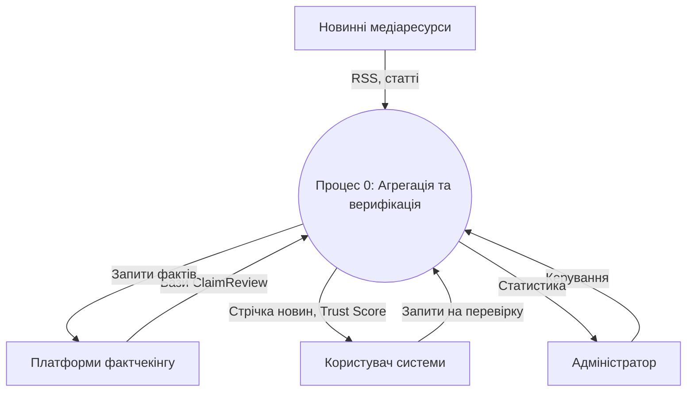
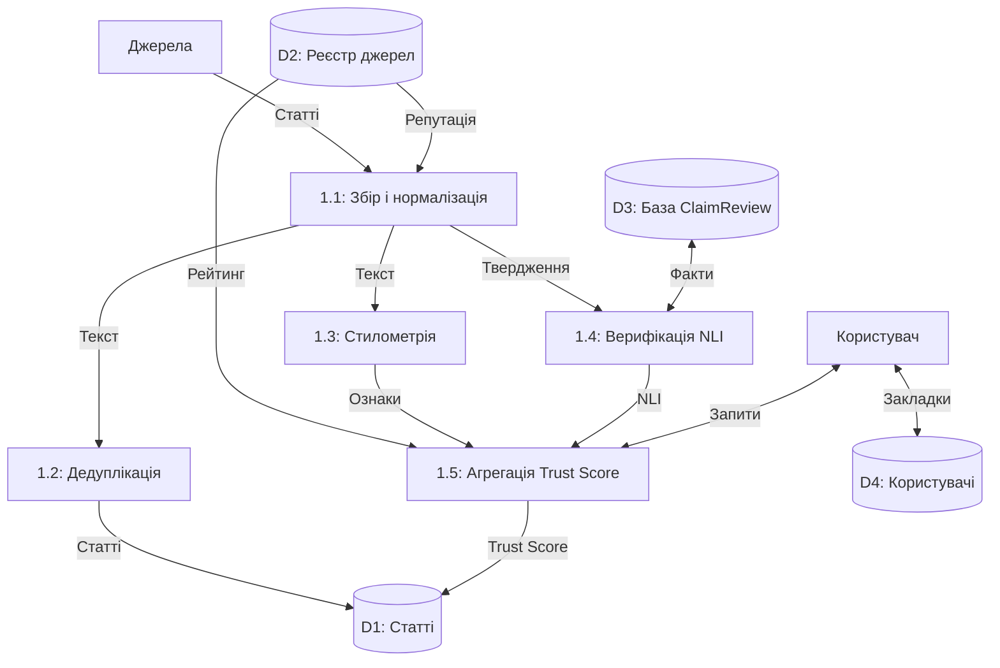

# РОЗДІЛ 2
## МОДЕЛЮВАННЯ ТА ВИЗНАЧЕННЯ ВИМОГ ДО ВЕБЗАСТОСУНКУ

### 2.1 Опис методів, технологій та математичного апарату оцінки достовірності новин

Побудова інтелектуального новинного агрегатора вимагає структурування потоку публікацій з оцінкою фактологічної надійності матеріалів. Евристичні фільтри та списки стоп-слів демонструють низьку якість проти маніпуляцій, оскільки дезінформація змінює форми та мімікрує під авторитетні джерела. Внаслідок цього виникає потреба у застосуванні апарату багатовимірного аналізу даних, теорії множин, моделей обробки мови (NLP) та прийняття рішень [1, 2].

Формалізація задачі полягає в наступному. Нехай задано потік новин $D = \{d_1, d_2, \dots, d_m\}$, де кожна стаття $d_i$ містить заголовок $H_i$, текст $B_i$ та метадані. Завдання полягає у побудові відображення $d_i \to S_{\text{trust}}(d_i) \in [0, 100]$ із вектором пояснень $\mathbf{x}_i \in \mathbb{R}^k$ (Explainable AI) [3]. Обчислення охоплюють три контури: дедуплікацію, стилометрію та семантичне виведення.

Перший математичний контур усуває надлишковість та кластеризує схожі рерайти новин. Пряме попарне зіставлення статей вимагає квадратичної складності $O(m^2)$, що унеможливлює потокову обробку. Для оптимізації застосовують апарат локально-чутливого гешування (LSH) та алгоритм MinHash [4, 5]. Тексти розбивають на множини $k$-шинглів (підпослідовностей слів). Схожість новин $D_a$ та $D_b$ оцінюють коефіцієнтом Жаккара:

$$J(D_a, D_b) = \frac{|S(D_a) \cap S(D_b)|}{|S(D_a) \cup S(D_b)|}, \qquad (2.1)$$

де
$D_a, D_b$ – аналізовані текстові матеріали новин;
$S(D)$ – множина унікальних $k$-шинглів тексту;
$|S(D_a) \cap S(D_b)|$ – кількість спільних шинглів;
$|S(D_a) \cup S(D_b)|$ – загальна кількість унікальних шинглів.

Множину шинглів проектують на сигнатурний вектор розмірності $K$ сімейством незалежних геш-функцій MinHash. Для швидкого виявлення дублікатів матрицю сигнатур розбивають на $b$ смуг по $r$ рядків ($K = b \cdot r$). Ймовірність потрапляння пари статей зі схожістю $s = J(D_a, D_b)$ в один кошик описується залежністю:

$$P_{\text{bucket}}(s) = 1 - (1 - s^r)^b, \qquad (2.2)$$

де
$s \in [0, 1]$ – коефіцієнт подібності Жаккара між парою статей;
$r$ – кількість геш-значень у межах однієї смуги;
$b$ – кількість незалежних смуг в індексі LSH.

Параметри $b = 20, r = 5$ задають поріг відсікання $t \approx (1/b)^{1/r} \approx 0{,}55$, забезпечуючи фільтрацію рерайтів зі швидкістю $O(m)$ [5].

Другий контур здійснює стилометричний аналіз тексту для виявлення маніпулятивних маркерів: клікбейту, емоційного тиску та змістової невідповідності [6]. Лексичну різноманітність публікації оцінюють індексом Гуро $R_{\text{lex}} = V / \sqrt{N}$, де $V$ – обсяг унікальних слів, а $N$ – довжина тексту. Семантичну узгодженість заголовка $H$ і тексту $B$ оцінюють косинусною подібністю векторних ембедингів $C_{\text{sim}}(H, B) = (\mathbf{v}_H \cdot \mathbf{v}_B) / (\|\mathbf{v}_H\| \|\mathbf{v}_B\|)$.

Інтегровану оцінку стилометричної маніпулятивності $M_{\text{click}}$ обчислюють через логістичну залежність:

$$M_{\text{click}} = \sigma \left( w_1 \cdot \rho_{\text{punct}} + w_2 \cdot \rho_{\text{caps}} + w_3 \cdot \rho_{\text{trig}} + w_4 \cdot (1 - C_{\text{sim}}(H, B)) \right), \qquad (2.3)$$

де
$\sigma(z) = \frac{1}{1 + e^{-z}}$ – логістична функція активації;
$\rho_{\text{punct}}$ – відносна щільність надлишкової пунктуації (!, ?, ...);
$\rho_{\text{caps}}$ – частка великих літер у словах заголовка;
$\rho_{\text{trig}}$ – відносна частота емоційних тригерних слів;
$C_{\text{sim}}(H, B)$ – косинусна подібність між заголовком і тілом новини;
$w_1, w_2, w_3, w_4$ – вагові коефіцієнти факторів ($\sum w_k = 1$).

Третій математичний контур забезпечує семантичне порівняння тверджень новини з базами ClaimReview за допомогою моделей природномовного виведення (NLI) [7]. Для пари з твердження $T$ та доказу $E$ модель трансформера XLM-RoBERTa формує розподіл імовірностей через Softmax [7]:

$$P(y = c \mid T, E) = \frac{\exp(\mathbf{w}_c^\top \mathbf{h}_{[\text{CLS}]} + b_c)}{\sum_{k \in \mathcal{C}} \exp(\mathbf{w}_k^\top \mathbf{h}_{[\text{CLS}]} + b_k)}, \qquad (2.4)$$

де
$\mathcal{C} = \{\text{Entailment}, \text{Contradiction}, \text{Neutral}\}$ – множина класів семантичного зв'язку;
$\mathbf{h}_{[\text{CLS}]} \in \mathbb{R}^d$ – вихідний контекстний вектор токена класифікації;
$\mathbf{w}_c, b_c$ – параметри ваг і зсуву класифікаційного шару для класу $c$.

Ймовірність $p_{\text{ent}}$ вказує на підтвердження тези, $p_{\text{con}}$ фіксує спростування факту, а нейтральний клас свідчить про відсутність відомостей у базі.

Підсумкова оцінка достовірності (Trust Score) формується на засадах багатокритеріального аналізу рішень (MCDA) за зваженою лінійною схемою з мультиплікативним штрафом [8]:

$$S_{\text{trust}} = 100 \cdot \left( \alpha \cdot R_{\text{src}} + \beta \cdot (1 - M_{\text{click}}) + \gamma \cdot V_{\text{fact}} \right) \cdot \Phi_{\text{pen}}, \qquad (2.5)$$

де
$S_{\text{trust}} \in [0, 100]$ – інтегрований індекс надійності новини;
$R_{\text{src}} \in [0, 1]$ – нормалізований рейтинг репутації домену джерела;
$M_{\text{click}} \in [0, 1]$ – показник клікбейту та стилометричних маніпуляцій;
$V_{\text{fact}} \in [0, 1]$ – ступінь фактологічної узгодженості твердження з базами перевірки;
$\alpha, \beta, \gamma$ – нормалізовані вагові коефіцієнти ($\alpha + \beta + \gamma = 1$);
$\Phi_{\text{pen}} \in (0, 1]$ – штрафний бар'єрний множник за прямі спростування.

Параметр фактологічної узгодженості $V_{\text{fact}}$ визначають з урахуванням результатів моделі NLI:

$$V_{\text{fact}} = \begin{cases} 
p_{\text{ent}}, & \text{якщо знайдено підтвердження в базі фактчекерів}, \\
0{,}5, & \text{якщо твердження відсутнє в реєстрах перевірки}, \\
1 - p_{\text{con}}, & \text{якщо зафіксовано суперечність із перевіреними фактами},
\end{cases} \qquad (2.6)$$

де
$p_{\text{ent}}$ – розрахована ймовірність семантичного підтвердження;
$p_{\text{con}}$ – розрахована ймовірність суперечності твердження фактам.

Штрафний множник $\Phi_{\text{pen}} = \exp(-\lambda \cdot \mathbb{I}_{\text{fake}})$ знижує підсумковий бал удвічі при фіксації спростованого фейку (де $\lambda = 0{,}693$, а $\mathbb{I}_{\text{fake}} \in \{0, 1\}$ – індикатор наявності спростування).

Для відображення в інтерфейсі розраховані значення $S_{\text{trust}}$ розподіляють за трьома інтервалами достовірності (табл. 2.1).

Таблиця 2.1 – Рівні достовірності новинного матеріалу та критерії їх класифікації

| Рівень довіри | Діапазон $S_{\text{trust}}$ | Індикатор інтерфейсу | Характеристика матеріалу |
| :--- | :--- | :--- | :--- |
| Високий (Verified) | 75 – 100 | Зелений маркер надійності | Джерело з білого списку, відсутність клікбейту, факти узгоджені з базами |
| Середній (Caution) | 45 – 74 | Жовтий маркер застереження | Нейтральне джерело, помірні стилістичні акценти, відсутність спростувань |
| Низький (High Risk) | 0 – 44 | Червоний маркер ризику | Анонімний канал або сумнівний сайт, високий рівень маніпуляцій чи фейк |

Математичний апарат поєднує дедуплікацію LSH, стилометрію та нейромережеве виведення. Це забезпечує швидкодію обробки потоків та надає обґрунтовану оцінку надійності новин за принципами Explainable AI.

---

#### Джерела до підрозділу 2.1:
1. Guo B., Ding Y., Yao L., Liang Y., Yu Z. The Future of False Information Detection on Social Media. ACM Computing Surveys. 2022. Vol. 55(4). P. 1–38.
2. Thorne J., Vlachos A. Automated Fact-Checking: Status quo and future challenges. Communications of the ACM. 2021. Vol. 64(8). P. 82–93.
3. Kotonya N., Toni F. Explainable Automated Fact-Checking for Public Health Claims. Proceedings of EMNLP 2021. 2021. P. 7740–7754.
4. Zhang Y., Wang J. Locality-Sensitive Hashing for Real-Time Text Stream Deduplication. IEEE Transactions on Big Data. 2022. Vol. 8(3). P. 712–724.
5. Barhamgi M., Bandara A. K., Yu Y., Belhajjame K. Designing Trustworthy News Aggregation Systems. ACM TOIT. 2022. Vol. 22(3). P. 1–28.
6. Minaee S., Kalchbrenner N., Cambria E., Nikzad N. Deep Learning--Based Text Classification. ACM Computing Surveys. 2021. Vol. 54(3). P. 1–40.
7. Hardalov M., Arora P., Nakov P., Augenstein I. A Survey on Stance Detection for Misinformation Identification. Findings of NAACL 2022. 2022. P. 54–77.
8. Zavadskas E. K., Turskis Z., Bausys M. Multi-Criteria Decision Making for Information Quality Assessment. Mathematics. 2022. Vol. 10(14). 2486.

---

### 2.2 Функціональне та інформаційне моделювання процесів обробки даних

Проєктування новинного агрегатора з оцінюванням достовірності вимагає формалізованого опису інформаційних контурів та взаємодії компонентів. Складність системи зумовлена гетерогенністю джерел, інтенсивністю публікацій та необхідністю паралельних операцій: очищення розмітки, дедуплікації, стилометрії, зіставлення з реєстрами фактчекінгу та розрахунку індексу довіри Trust Score.

Для побудови функціональної структури застосовують методологію структурного аналізу (SADT), нотацію діаграм потоків даних (DFD) Гейна–Сарсона та стандарти CASE-моделювання [9, 10]. Такий підхід відокремлює інформаційну логіку від деталей реалізації, фіксує межі системи, зовнішні сутності, внутрішні сховища та вектори обміну даними.

Контекстний рівень відображає взаємодію вебзастосунку із зовнішнім середовищем. Межі системи охоплюють збір матеріалів, обробку контенту, звернення до реєстрів фактчекінгу та видачу персоналізованих новин. На нульовому рівні декомпозиції (DFD Рівень 0) виділено чотири зовнішні сутності:
1. Новинні медіаресурси (RSS канали, вебсайти) – постачають статті, заголовки та метадані публікацій.
2. Платформи фактчекінгу (ClaimReview, StopFake, VoxCheck) – надають дані про зафіксовані дезінформаційні тези та спростування.
3. Користувач системи (User) – надсилає запити на читання стрічки, ініціює експрес-перевірку та зберігає закладки.
4. Адміністратор системи (Admin) – налаштовує перелік джерел, веде списки доменів, переглядає логи та налаштовує скоринг.

Контекстну модель інформаційної взаємодії представлено на рисунку 2.1.

Рисунок 2.1 – Контекстна діаграма потоків даних (DFD Рівень 0) функціонування вебзастосунку

Для аналізу внутрішніх механізмів обробки даних виконано функціональну декомпозицію процесу нульового рівня. Діаграма першого рівня (DFD Рівень 1) розбиває конвеєр на п'ять процесів та визначає взаємодію з чотирма накопичувачами даних [11, 12]:

1. Процес 1.1: Збір, екстракція та нормалізація контенту. Асинхронний планувальник опитує RSS-канали. Документи очищаються від шуму, банерів і реклами. Текст токенізується та скеровується на дедуплікацію.

2. Процес 1.2: LSH-індексація та виявлення дублікатів. Будує $k$-шинґли та сигнатури MinHash. Через бакети LSH виявляються дублікати; схожі матеріали групуються у спільний кластер без повторної обробки.

3. Процес 1.3: Стилометричний аналіз та індикація маніпуляцій. Обчислює параметри тексту: індекс Гуро, частку слів у верхньому регістрі, пунктуаційну щільність та косинусну подібність заголовка й тіла новини.

4. Процес 1.4: Семантична верифікація тверджень. Вилучає фактичні тези з тексту. У базі спростувань здійснює семантичний пошук доказів; модель NLI визначає клас логічного зв'язку.

5. Процес 1.5: Агрегація індексу довіри (Trust Score). Поєднує стилометрію, результати фактчекінгу та репутацію джерела у підсумковий бал $S_{\text{trust}}$ від 0 до 100, формуючи пояснювальний вектор XAI.

Взаємодія процесів спирається на чотири накопичувачі даних:
- D1 «Статті та публікації» – збереження текстів, заголовків, URL, часових міток, балу Trust Score та стилометрії;
- D2 «Реєстр джерел та репутації» – адреси RSS-потоків, періодичність опитування, рівні довіри, списки видань;
- D3 «База фактчекінгу ClaimReview» – перевірені твердження, висновки експертів, фрагменти спростувань та ембединги;
- D4 «Користувачі, закладки та історія» – профілі користувачів, персональні закладки та історія перевірок.

Схему декомпозиції процесів першого рівня та зв'язків зі сховищами наведено на рисунку 2.2.

Рисунок 2.2 – Діаграма потоків даних першого рівня (DFD Рівень 1) декомпозиції конвеєра обробки новин

Для аналізу продуктивності конвеєра визначено математичний опис затримки проходження даних [13]. Загальний час наскрізної обробки однієї статті $T_{\text{total}}$ складається із послідовних та паралельних етапів:

$$T_{\text{total}} = T_{\text{ingest}} + T_{\text{dedup}} + \max(T_{\text{sty}}, T_{\text{sem}}) + T_{\text{score}} + T_{\text{store}}, \qquad (2.7)$$

де
$T_{\text{total}}$ – повний час проходження новини через аналітичний конвеєр;
$T_{\text{ingest}}$ – тривалість отримання коду, синтаксичного розбору та очищення тексту;
$T_{\text{dedup}}$ – тривалість розрахунку $k$-шинглів та пошуку збігів в індексі MinHash LSH;
$T_{\text{sty}}$ – тривалість обчислення стилометричних коефіцієнтів та індикатора клікбейту;
$T_{\text{sem}}$ – тривалість семантичного пошуку доказів та логічного виведення NLI;
$T_{\text{score}}$ – тривалість розрахунку Trust Score та формування пояснення XAI;
$T_{\text{store}}$ – затримка транзакційного запису результатів у базу даних.

Паралельне виконання стилометрії та верифікації скорочує час обробки, оптимізуючи навантаження на сервери.

Для оцінювання повноти збереження змісту тексту після видалення шуму та службових слів застосовують інформаційну ентропію за Шеноном [14]:

$$H(D) = - \sum_{i=1}^{V} p(w_i) \cdot \log_2 p(w_i), \qquad (2.8)$$

де
$H(D)$ – інформаційна ентропія розподілу слів у нормалізованому тексті новини;
$V$ – обсяг словника унікальних повнозначних лексем очищеного матеріалу;
$p(w_i)$ – відносна частота появи лексеми $w_i$ в аналізованому тексті;
$w_i$ – окрема лексема з множини збережених інформативних слів.

Збереження стабільного рівня ентропії $H(D)$ свідчить про відсутність спотворення змісту при очищенні тексту.

Специфікацію основних інформаційних потоків конвеєра систематизовано в таблиці 2.2.

Таблиця 2.2 – Специфікація основних інформаційних потоків конвеєра обробки та верифікації новин

| Назва потоку | Джерело | Приймач | Формат | Опис переданої інформації |
| :--- | :--- | :--- | :--- | :--- |
| Потік сирих новин | Медіаресурси | Процес 1.1 | XML, HTML | Заголовки, метадані публікації, вихідний текст статті та посилання |
| Очищений текст | Процес 1.1 | Процеси 1.2–1.4 | JSON | Нормалізований текст без реклами, токени слів, заголовок, URL |
| Сигнатури схожості | Процес 1.2 | Накопичувач D1 | Вектор int32 | Сигнатурні відбитки MinHash та ідентифікатор кластера дублікатів |
| Стилометричний вектор | Процес 1.3 | Процес 1.5 | Dict float | Індекс Гуро, частка капслоку, щільність знаків, косинусна подібність |
| Фактологічні докази | Накопичувач D3 | Процес 1.4 | Вектори float | Перевірені твердження, фрагменти спростувань, посилання на фактчеки |
| Підсумковий профіль | Процес 1.5 | Накопичувач D1 | Запис БД | Trust Score (0-100), вектор пояснень XAI, категорія ризику |

Побудовані функціональні та інформаційні моделі забезпечують узгодженість контурів обробки даних, оптимізують паралельне виконання аналітичних операцій та слугують базою для формування специфікації вимог до системи.

---

#### Джерела до підрозділу 2.2:
9. Пахомова В. М., Маслак А. В. Моделювання виявлення мережних аномалій на основі нейро-нечітких технологій. *Вчені записки ТНУ. Серія: Технічні науки*. 2022. Т. 33 (72), № 5. С. 135–140.
10. Погорілий С. Д., Білецький П. В. Алгоритм пошуку кореферентних об’єктів в україномовних текстах з використанням дерев рішень. *Проблеми програмування*. 2022. № 3–4. С. 278–288.
11. Сеник А. П., Манзій О. С., Футрик Ю. В., Степанюк О. І., Сеник Ю. А. Інформаційна система підтримки процесів прийняття рішень при формуванні портфеля цінних паперів. *Вісник НУ «Львівська політехніка». Серія: Інформаційні системи та мережі*. 2022. Вип. 11. С. 39–55.
12. Дичка І. А., Сулейманов С. С., Ковальчук В. В. Оцінювання ефективності засобів розпізнавання емоційного забарвлення фрагментів тексту. *Вчені записки ТНУ. Серія: Технічні науки*. 2023. Т. 34 (73), № 3(1). С. 130–135.
13. Мельник А. О., Кіт І. В. Застосування великих мовних моделей для автоматизації обробки звернень. *Вісник НУ «Львівська політехніка». Серія: Інформаційні системи та мережі*. 2023. Вип. 13. С. 45–54.
14. Чупілко Т. В., Савицька Л. В. Проектування і програмна реалізація автоматизованої системи відвідуваності та аналізу даних. *Інформаційні технології та комп'ютерна інженерія*. 2023. № 2(57). С. 84–92.

---

### 2.3 Специфікація вимог до програмного забезпечення

Специфікація вимог визначає поведінку вебзастосунку новинного агрегатора з виявленням неправдивої інформації. Вона охоплює комплекс функціональних і нефункціональних вимог, опис інформаційного й технічного забезпечення, структури архітектури та критеріїв якості.

1. Призначення та межі проєкту
1.1 Призначення системи
Вебзастосунок призначений для автоматизованого збору новин із відкритих джерел, усунення дублікатів, стилометричного виявлення маніпуляцій, семантичного зіставлення тез із базою ClaimReview та розрахунку індексу довіри Trust Score із поясненнями XAI.
1.2 Погодження, що ухвалені в програмній документації
	специфікація вимог базується на технічному завданні проєкту;
	взаємодія клієнта та сервера реалізована через RESTful API у форматі JSON;
	текстові дані обробляються у кодуванні UTF-8;
	розрахунок показників довіри та стилометрії виконується на стороні сервера.
1.3 Межі проєкту ПЗ
	система охоплює вебінтерфейс (Next.js) та серверну частину (FastAPI, PostgreSQL з pgvector);
	не включає розробку мобільних застосунків;
	не передбачає блокування сторонніх ресурсів в Інтернеті;
	не здійснює генерацію новин за допомогою штучного інтелекту.

2. Загальний опис
2.1 Сфера застосування
Вебзастосунок призначений для використання читачами новин, журналістами й аналітиками для моніторингу інформаційних потоків і перевірки достовірності матеріалів.
2.2 Характеристики користувачів
Система розрахована на три категорії користувачів:
	неавторизований відвідувач – перегляд стрічки новин, пошук, разова експрес-перевірка;
	читач – налаштування категорій, збереження закладок, історія перевірок, доступ до XAI;
	адміністратор – управління каталогом джерел, коригування репутації доменів, моніторинг завдань.
2.3 Загальна структура і склад системи
	клієнтська частина – вебінтерфейс на базі Next.js із компонентами shadcn/ui;
	серверна частина – RESTful API на базі FastAPI з фоновим планувальником;
	аналітичний конвеєр – модулі LSH MinHash, стилометрії, векторного пошуку та NLI;
	база даних – СУБД PostgreSQL із розширенням pgvector.
2.4 Загальні обмеження
	функціонування вимагає стабільного інтернет-з'єднання;
	сумісність із сучасними браузерами Chrome, Firefox, Safari, Edge;
	швидкість парсингу лімітується правилами robots.txt.

3. Функції системи
3.1 Реєстрація та авторизація користувачів
3.1.1 Опис функції
Реєстрація нових облікових записів, авторизація за паролем або OAuth2 Google та розподіл прав за ролями (читач, адміністратор).
3.1.2 Вхідна і вихідна інформація
	вхідна: email, пароль, логін;
	вихідна: статус операції, токени JWT (Access, Refresh).
3.1.3 Функціональні вимоги
	реєстрація через email із перевіркою пароля;
	хешування паролів за алгоритмом bcrypt;
	видача токенів JWT (Access – 30 хв, Refresh – 7 діб);
	розмежування доступу за ролями.

3.2 Автоматизована агрегація новин
3.2.1 Опис функції
Періодичне опитування RSS/Atom каналів, розбір XML, завантаження публікацій та очищення тексту від шуму.
3.2.2 Вхідна і вихідна інформація
	вхідна: адреси RSS-потоків із бази даних, сирий HTML/XML код;
	вихідна: структурована новина (заголовок, текст, автор, дата, URL, домен).
3.2.3 Функціональні вимоги
	асинхронне опитування RSS-потоків кожні 15–30 хвилин;
	синтаксичний аналіз XML бібліотекою Feedparser;
	вилучення змісту статті за допомогою Trafilatura;
	очищення тексту від банерів і збереження у UTF-8.

3.3 Дедуплікація та кластеризація новин
3.3.1 Опис функції
Виявлення дублікатів і рерайтів, об'єднання схожих матеріалів у сюжети за алгоритмом MinHash LSH.
3.3.2 Вхідна і вихідна інформація
	вхідна: нормалізований текст статті, параметри індексу LSH;
	вихідна: сигнатура MinHash, ідентифікатор сюжету, коефіцієнт схожості.
3.3.3 Функціональні вимоги
	розбиття тексту на послідовності 3-шинглів;
	обчислення сигнатури MinHash розмірністю 100 гешів;
	індексація LSH (20 смуг по 5 рядків, поріг 0,55);
	об'єднання схожих новин у сюжет.

3.4 Стилометричний аналіз тексту
3.4.1 Опис функції
Аналіз лексичного різноманіття, пунктуації, капслоку та відповідності заголовка тексту для оцінки клікбейту.
3.4.2 Вхідна і вихідна інформація
	вхідна: заголовок, текст новини, словник маркерів;
	вихідна: індекс Гуро, частка капслоку, пунктуаційна щільність, бал клікбейту.
3.4.3 Функціональні вимоги
	розрахунок індексу Гуро для оцінки лексики;
	виявлення частки великих літер у заголовку;
	підрахунок знаків оклику й питань;
	оцінка семантичної близькості заголовка й тіла статті.

3.5 Семантична верифікація тверджень
3.5.1 Опис функції
Виділення тез із тексту, векторний пошук у базі ClaimReview та класифікація зв'язку (підтверджено, спростовано, нейтрально).
3.5.2 Вхідна і вихідна інформація
	вхідна: текст статті, векторні ембединги ClaimReview;
	вихідна: список збігів із фактчеками, ідентифікатор спростування, ймовірності NLI.
3.5.3 Функціональні вимоги
	вилучення тез із тексту новини;
	побудова ембедингів мовною моделлю;
	пошук у pgvector за косинусною відстанню;
	класифікація відношення моделлю NLI.

3.6 Розрахунок індексу довіри Trust Score
3.6.1 Опис функції
Розрахунок рейтингу довіри до статті на основі репутації джерела, стилометрії та фактчекінгу, формування факторів ризику.
3.6.2 Вхідна і вихідна інформація
	вхідна: рейтинг домену, бал клікбейту, узгодженість із фактчеками, ознаки спростування;
	вихідна: Trust Score (0–100), категорія довіри, фактори пояснення XAI.
3.6.3 Функціональні вимоги
	розрахунок індексу за зваженою моделлю;
	накладання штрафного бар'єра при виявленні спростування;
	розподіл за рівнями (Verified, Caution, High Risk);
	автоматичне формування факторів оцінки.

3.7 Експрес-перевірка тексту та посилань
3.7.1 Опис функції
Оперативна перевірка довільного фрагмента тексту або посилання на маніпулятивність і збіги з фактчеками.
3.7.2 Вхідна і вихідна інформація
	вхідна: фрагмент тексту (до 10000 знаків) або URL новини;
	вихідна: звіт із Trust Score, графіком факторів та спростуваннями.
3.7.3 Функціональні вимоги
	форма вибору перевірки тексту або посилання;
	вилучення тексту за посиланням у реальному часі;
	запуск стилометричного аналізу та перевірки фактів;
	збереження результату в історії перевірок.

3.8 Персоналізація стрічки та закладки
3.8.1 Опис функції
Налаштування стрічки за інтересами читача, фільтрація за рівнем довіри й категоріями та ведення закладок.
3.8.2 Вхідна і вихідна інформація
	вхідна: категорії, поріг фільтра Trust Score, дії з закладками;
	вихідна: відфільтрована стрічка новин, колекція закладок.
3.8.3 Функціональні вимоги
	фільтрація стрічки за тематичними категоріями;
	налаштування мінімального порогу Trust Score;
	пошук за заголовками та текстом новин;
	збереження статей у закладки.

3.9 Адміністрування джерел та аналітика
3.9.1 Опис функції
Контроль парсерів, додавання нових RSS-каналів, зміна репутації доменів та перегляд системних метрик.
3.9.2 Вхідна і вихідна інформація
	вхідна: параметри каналів (назва, URL, категорія), рейтинги доменів;
	вихідна: стан доступності каналів, черги завдань, графіки надійності.
3.9.3 Функціональні вимоги
	додавання, редагування та вимкнення каналів;
	перегляд статусів останнього опитування джерел;
	ведення білого та чорного списків доменів;
	відображення статистики надійності новин.

4. Вимоги до інформаційного забезпечення
4.1 Джерела і зміст вхідної інформації (даних)
	медіаресурси: потоки RSS/Atom, заголовки, тексти, дати, URL статей;
	репозиторії фактчекінгу: масиви ClaimReview, вердикти спростувань;
	користувачі: облікові відомості (email, пароль, логін), тексти для перевірки;
	адміністратори: параметри каналів новин, рейтинги репутації доменів.
4.2 Нормативно-довідкова інформація
	класифікатор категорій публікацій;
	довідник доменів із коефіцієнтами репутації;
	словник слів-тригерів клікбейту;
	класифікатор вердиктів фактчекінгу ClaimReview.
4.3 Вимоги до способів організації, збереження та ведення інформації
	усі дані зберігаються в СУБД PostgreSQL із підтримкою ACID;
	вектори ембедингів зберігаються за допомогою pgvector;
	паролі зберігаються у зашифрованому вигляді bcrypt із сіллю;
	тексти статей зберігаються у нормалізованому вигляді;
	резервне копіювання БД проводиться щодня.

5. Вимоги до технічного забезпечення
	клієнтська частина: сучасний веббраузер (Chrome, Firefox, Safari, Edge) на ПК, планшетах чи смартфонах;
	серверна частина: процесор x86-64 (від 4 ядер, рекомендовано 8 ядер), оперативна пам'ять від 16 ГБ, SSD NVMe від 100 ГБ;
	мережеве забезпечення: підключення до Інтернету від 100 Мбіт/с, статична IP-адреса, протокол TLS 1.3.

6. Вимоги до програмного забезпечення
6.1 Архітектура програмної системи
Клієнт-серверна архітектура з використанням RESTful API. Архітектура забезпечує розділення логіки, представлення та збереження даних, масштабованість і високу надійність.
6.2 Системне програмне забезпечення
	ОС сервера: Linux (Ubuntu Server 22.04 LTS);
	контейнеризація: Docker 24.0+ та Docker Compose 2.20+;
	СУБД: PostgreSQL 15.0+ із розширенням pgvector 0.5+.
6.3 Мережне програмне забезпечення
	протоколи HTTP/HTTPS та WebSocket;
	вебсервер Nginx 1.22+ або Traefik;
	OpenSSL 3.0+ для шифрування TLS 1.3.
6.4 Програмне забезпечення ведення інформаційної бази
	СУБД: PostgreSQL 15.0+;
	ORM для FastAPI: SQLAlchemy 2.0+ з asyncpg;
	система міграцій схеми БД: Alembic.
6.5 Мова і технологія розробки ПЗ
– frontend: Next.js 16+, React 19, TypeScript 5.0+, Tailwind CSS 4.0, shadcn/ui;
– backend: Python 3.11+, FastAPI, Pydantic, Trafilatura, Feedparser, Sentence-Transformers;
– БД: PostgreSQL з pgvector.

7. Вимоги до зовнішніх інтерфейсів
7.1 Інтерфейс користувача
– адаптивність для десктопних, планшетних та мобільних пристроїв;
– навігаційне меню з чіткою структурою розділів;
– дизайн із колірною диференціацією рівнів довіри (зелений, жовтий, червоний).
7.2 Апаратний інтерфейс
Не потребує спеціального обладнання, стандартне підключення до Інтернету, робота на ПК і мобільних пристроях.
7.3 Програмний інтерфейс
RESTful API застосунку для сервісів автентифікації, новин, перевірки контенту, фактчекінгу та закладок, а також API Google OAuth2.
7.4 Комунікаційний протокол
Захищені протоколи HTTPS та WebSocket.

8. Властивості програмного забезпечення
8.1 Доступність
– час безперебійної роботи становить не менше 99,5% часу;
– доступність 24/7 з технічними перервами до 3 годин на місяць;
– час відгуку системи не перевищує 1,5 с для 95% запитів;
– одночасна робота до 1000 активних користувачів.
8.2 Супроводжуваність
– модульна архітектура для заміни компонентів і моделей NLP;
– автоматизоване тестування з покриттям коду від 80%;
– журнал змін та автогенерація OpenAPI.
8.3 Переносимість
– незалежність від платформи завдяки Docker;
– кросбраузерність інтерфейсу;
– адаптивність до різних пристроїв.
8.4 Продуктивність
– відповіді API до 250 мс при 150 запитах/с;
– експрес-перевірка тексту до 3 секунд;
– завантаження головної сторінки до 2 секунд.
8.5 Надійність
– регулярне резервне копіювання бази даних;
– перезапуск контейнерів при збоях;
– журналювання системних помилок.
8.6 Безпека
– шифрування трафіку через HTTPS (TLS 1.3);
– хешування паролів за алгоритмом bcrypt;
– захист від атак SQL-ін'єкцій, XSS, CSRF;
– контроль доступу на основі ролей і токенів JWT.

9. Інші вимоги
– можливість підключення додаткових мовних локалізацій інтерфейсу;
– перспектива інтеграції міжнародних баз перевірки фактів;
– можливість розширення системи шляхом підключення нових мовних моделей.

---

### Висновки до розділу 2

У другому розділі змодельовано аналітичні процеси вебзастосунку та розроблено модель оцінки достовірності Trust Score із поясненнями XAI. Поєднання методів MinHash LSH, індексу Гуро, семантичного зіставлення з ClaimReview у pgvector та діаграм DFD і ER формалізує повний цикл верифікації новинних потоків.

Розроблена специфікація вимог фіксує межі проєкту, ролі користувачів, дев'ять функціональних модулів та критерії надійності й безпеки. Вибір стеку FastAPI, Next.js і Docker закладає цілісну основу для проєктування архітектури та програмної реалізації вебзастосунку у наступному розділі.
